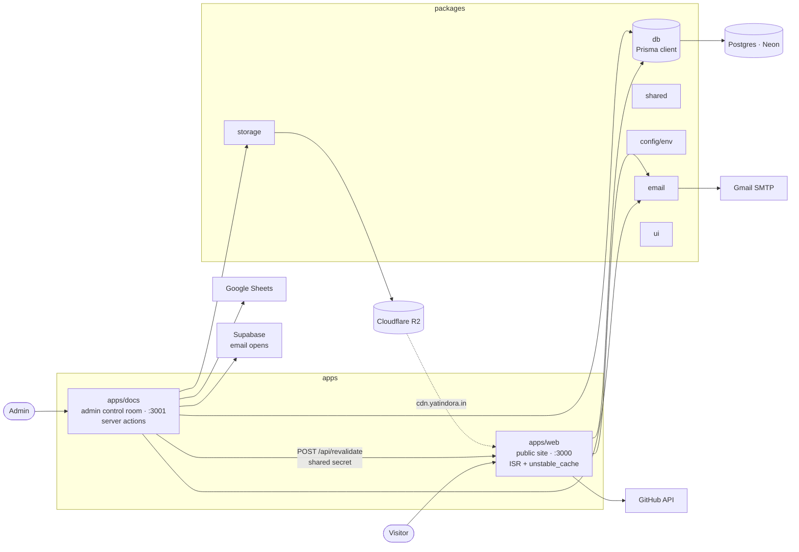
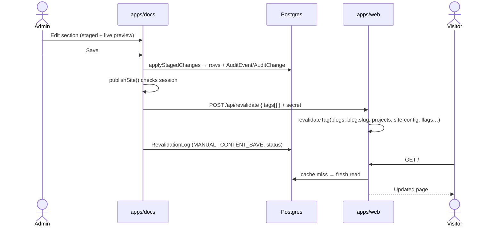
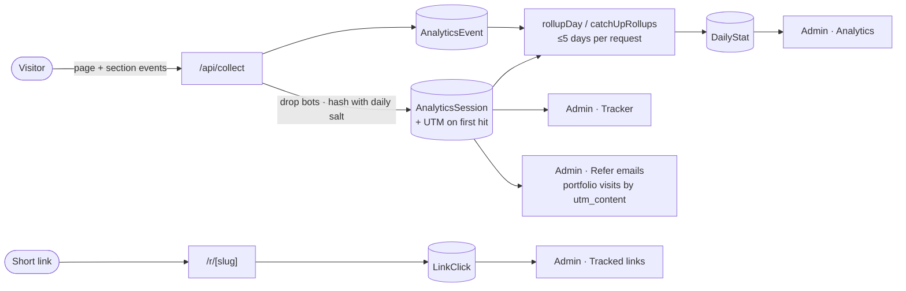
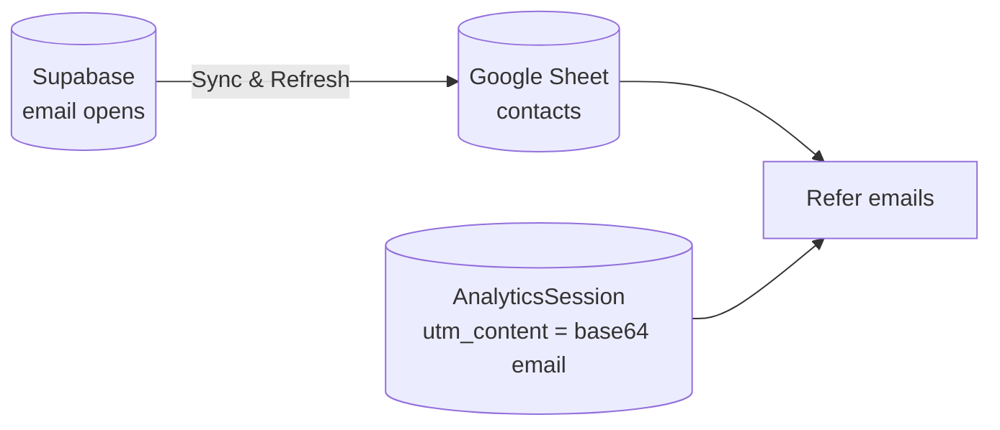

<div align="center">

# Yatin Dora — Portfolio

**A fully database-driven portfolio with its own control room.**

A public site that renders entirely from Postgres, and an admin app that edits every pixel of it
and pushes changes live — no redeploys, no hardcoded copy.

[**yatindora.in**](https://yatindora.in) · [GitHub](https://github.com/YatinDora81/Portfolio)


</div>

---

## Contents

- [Highlights](#highlights)
- [Architecture](#architecture)
- [Features — public site](#features--public-site)
- [Features — admin control room](#features--admin-control-room)
- [Security](#security)
- [Data flows](#data-flows)
- [Packages](#packages)
- [Database](#database)
- [Tech stack](#tech-stack)
- [Getting started](#getting-started)
- [Gotchas](#gotchas)

---

## Highlights

- **Zero hardcoded content.** Copy, sections, projects, blogs, the background, the cat, even which
  hero variant is live — all rows in Postgres, all editable from the admin.
- **Edit → stage → publish.** Changes are staged in the admin with live previews, saved in one
  batch, and pushed to the public site through tag-based on-demand ISR.
- **First-party, cookieless analytics.** Sessions, section dwell time, UTM attribution, daily
  rollups and Recharts dashboards — visitors are hashed with a daily-rotating salt, never cookied.
- **A real file manager over Cloudflare R2.** Presigned direct uploads, folder trees, bulk
  move/copy/delete, and deletion guarded by a reference scan of the content tables.
- **Outreach tooling.** A Google Sheets–backed referral campaign view, Supabase email-open sync,
  UTM attribution tracking, and short links with QR codes and click history.
- **A private notes vault** with a query language, zip import/export, and spaced-revision grading
  — the most heavily tested part of the repo.
- **Audit everything.** Every admin mutation writes an `AuditEvent` with per-field `AuditChange`
  rows; roles, account lockout, OTP recovery and feature-flag kill switches included.

---

## Architecture

### System overview



### Monorepo layout

```
portfolio/
├── apps/
│   ├── web/            # public site                  (port 3000)
│   └── docs/           # admin control room           (port 3001)
├── packages/
│   ├── db/             # Prisma schema, client, DB-side helpers
│   ├── config/         # one Zod env schema, validated at boot
│   ├── shared/         # framework-free utilities used by both apps
│   ├── email/          # SMTP transport + templates
│   ├── storage/        # R2 client + media key rules
│   ├── ui/             # shared React components
│   ├── eslint-config/
│   └── typescript-config/
├── turbo.json
└── .env.example        # the single env reference for the whole repo
```

Both apps alias `@/*` to `./app/*`. The database package is imported **bare** as `db`; everything
else uses the `@repo/*` scope with subpath exports (`@repo/shared/tags`, `@repo/ui/button`).

---

## Features — public site

`apps/web` is one server-rendered page plus a route per blog post.

### Sections

**Hero → About → Skills → Experience → Projects → Blogs → Thought of the Day → Contact**

| Section | What's interesting |
|---|---|
| Hero | Versioned variants (`SiteVersion`) switchable from the admin, rotating titles, skill badges, resume link, socials |
| About | Paragraphs, education, and a `whoami` terminal |
| Skills | A "periodic table of code" — category filter chips, brand-tinted hover states, and a "used in" map linking skills to projects and roles |
| Experience / Projects | Bullets, skills, images and live-health probes per project, all ordered from the admin |
| Blogs | Markdown posts at `/blog/[slug]`, individually cache-tagged |
| Thought of the Day | Rotating quotes |
| Contact | Purpose-driven form with layered spam defenses and an email notification |

### Experience & UX

- **⌘K command menu**, a scroll-driven **tuner rail**, and a **terrain background** layer
- The **oneko cat** that chases your cursor — and also fronts the 404 and error pages
- **Theme toggle** animated as a native view-transition sweep (`experimental.viewTransition`)
- Magnetic links, reduced-motion and touch detection hooks
- **Draft Mode preview** behind a signed token, with a preview banner

### Performance

- `revalidate = 86400` (24h ISR) on the landing page and blog posts, cut short by on-demand
  revalidation from the admin
- Reads go through tagged `unstable_cache` in `app/lib/data.ts`, so a single blog post or project
  can be busted on its own
- Everything below the hero is wrapped in `HydrateWhenVisible` — server HTML first, hydration only
  as it nears the viewport
- AVIF/WebP images with a ~31-day cache TTL; remote images only from `cdn.yatindora.in`
- Generated `opengraph-image.tsx`, `sitemap.ts` and `robots.ts`

### Public API

| Route | Method | Purpose |
|---|---|---|
| `/api/revalidate` | POST | On-demand ISR. Secret via `x-revalidate-secret` header or `secret` field, compared with `safeEqual`. Takes `paths[]` and `tags[]` (≤100 entries, ≤512 chars each); an empty body revalidates the whole site. |
| `/api/contact` | POST | Contact intake: Zod validation, spam scoring, timing token, optional Turnstile, notification email |
| `/api/contact/token` | GET | Issues the HMAC timing token the form posts back |
| `/api/collect` | POST | First-party analytics beacon. Drops bots, batches events, records UTM attribution on the session's first hit |
| `/api/blogs/[slug]` | GET | Blog post JSON |
| `/api/github/refresh` | POST | Refreshes the cached GitHub profile and contribution years |
| `/api/preview` · `/api/preview/exit` | GET | Enter / exit Draft Mode with a signed preview token |
| `/r/[slug]` | GET | Short-link redirect: looks up a `TrackedLink`, records a `LinkClick` in `after()`, 302s with `no-store` |

---

## Features — admin control room

`apps/docs` mirrors the public page top to bottom, then adds operations and outreach tooling.

### The page, section by section

Background · Hero · Cat · About (paragraphs, education) · Terminal (`whoami`) · Skills ·
Experience · Projects · Blogs · Thought of the day · Contact purposes

Every editor shows a **live preview** of its section and stages edits instead of writing
immediately. A **save bar** applies the staged batch through `applyStagedChanges` and then
publishes. Content moves through `DRAFT → SCHEDULED → PUBLISHED → ARCHIVED`, with status tabs,
row actions and a "run due" trigger for scheduled items.

### Workspace

| Screen | What it does |
|---|---|
| **Dashboard** | Overview of the whole site and recent activity |
| **Inbox** | Contact messages with statuses, threaded replies, and reusable reply templates |
| **Notes** | Private Q&A vault — see below |
| **Refer emails** | Outreach contacts from a Google Sheet: status, generated subject/body (sanitised HTML preview with dark mode), open counts, sent/opened timeline, portfolio-visit attribution, filters, pagination, and 40-second auto-sync |
| **Tracker** | UTM attribution over analytics sessions: date-range picker, top-campaign chart, searchable table with source/medium/campaign filters and base64 `utm_content` decoding |
| **Tracked links** | Short links with QR codes, click timelines and per-link stats |
| **Analytics** | Cookieless traffic dashboards — sessions, events and section dwell, over daily rollups |

### Site & access

| Screen | What it does |
|---|---|
| **Site chrome** | Navbar and footer settings with a live preview |
| **Admins & roles** | `OWNER` / `ADMIN` / `SUB_ADMIN` management |
| **Change history** | Audit log: `AuditEvent` per mutation, `AuditChange` per field |
| **Revalidation** | Cache health and every revalidation attempt, with trigger and status |
| **Feature flags** | DB-backed kill switches — per-section visibility, the contact form, analytics, easter eggs |
| **Media** | Full R2 file manager — see below |
| **Icon library** | Browsable reference of every icon key |

### Notes vault

- `NoteNode` is a self-referencing tree with a materialised `path` (`/dsa/graphs/dijkstra`)
- Folders and questions, reorderable siblings, soft-delete via trash, **zip import/export**
- A small **search language** — words, phrases, `tag:`, `in:<path>`, `is:` filters and negation —
  parsed in `lib/notes/query.ts` and compiled to Prisma / SQL
- **Revise mode** grades each answer on five confidence levels: unrated → again → shaky → good → solid
- Covered by nine `bun:test` suites under `app/lib/notes/` (query, SQL, paths, import, export,
  zip, markdown, vault view, core integration)

### Media manager (Cloudflare R2)

- **Direct uploads** via presigned PUT (`UPLOAD_URL_TTL_SECONDS = 300`), then `completeUpload`
  writes the `MediaAsset` row. Max 10 MB; images plus a document allowlist; alt text required
- **Keys** are sanitised and depth-capped at 6; empty folders are held open by marker objects
- **Browser:** paged folder tree, card or table view, selection tray, inspector, context menu,
  and folder drops that preserve structure
- **Move, rename, copy, bulk delete** on selections and whole prefixes — `planFolderDelete`
  previews the damage before `deleteFolder` commits
- **Guarded deletion:** `lib/media-references.ts` scans content tables, so in-use files are
  blocked rather than deleted; bucket objects with no row surface as orphans you can adopt

---

## Security

| Layer | Implementation |
|---|---|
| Session | jose HS256 JWT in an httpOnly `admin_session` cookie, 7-day `maxAge` |
| Route guard | `middleware.ts` redirects to `/login` without a valid cookie and clears invalid ones |
| Authorization | Role checks (`OWNER` / `ADMIN` / `SUB_ADMIN`) in layouts and server actions |
| Lockout | 3 failed passwords lock the account (`MAX_FAILED_ATTEMPTS = 3`) |
| Recovery | Emailed OTP (5-minute validity), offered **only** after a lockout; password reset by email link |
| Passwords | bcrypt |
| Public forms | HMAC timing token, honeypot, spam scoring, Turnstile, DB-backed rate limiter (`RateLimitBucket`) — each independently disabled by leaving its env var unset |
| Headers | Full CSP and HSTS in `next.config.js` |
| Analytics privacy | Daily-rotated salt, hashed visitors, no cookies |
| Config | Every env var validated at boot by one Zod schema |

---

## Data flows

### How an edit reaches the site



Scheduled content is promoted by `publish-due`; jobs that must not overlap take a `JobLock`.

### Analytics & attribution



### Referral outreach



The sheet is read through a 40-second in-memory cache; "Sync & Refresh" pushes Supabase open
counts back into the sheet, then reloads. Portfolio visits are matched by decoding `utm_content`.

---

## Packages

| Package | Contents |
|---|---|
| `db` | Prisma schema (43 models, 17 enums), pooled client, and subpath helpers: `lock`, `maintenance`, `publish-due`, `rate-limit`, `rollup`, `visibility`, `analytics-salt` |
| `config` | `@repo/config/env` — the single Zod schema every env var passes through |
| `shared` | `attribution`, `crypto`, `dates`, `flags`, `form-token`, `logger`, `preview-token`, `request-facts`, `result`, `slug`, `spam`, `tags`, `turnstile` |
| `email` | `auth`, `html`, `send`, `templates` |
| `storage` | `r2` (S3 client, presigning, list/copy/delete) and `media` (key rules, type and size limits) |
| `ui` | `button`, `card`, `code`, `icons`, `terminal`, `terrain` |
| `eslint-config`, `typescript-config` | Shared tooling configs |

---

## Database

**43 models, 17 enums**, grouped by domain:

| Domain | Models |
|---|---|
| Site content | `SiteSettings`, `HeroContent`, `HeroTitle`, `HeroSkillBadge`, `SocialLink`, `AboutParagraph`, `Education`, `Skill`, `Experience`, `ExperienceBullet`, `ExperienceSkill`, `Project`, `ProjectBullet`, `ProjectSkill`, `ProjectImage`, `ProjectHealth`, `Blog`, `Quote` |
| Contact | `ContactPurpose`, `ContactMessage`, `MessageReply`, `ReplyTemplate` |
| Analytics | `AnalyticsSalt`, `AnalyticsSession`, `AnalyticsEvent`, `DailyStat`, `RollupRun`, `TrackedLink`, `LinkClick` |
| Notes | `NoteNode`, `NoteAnswer` |
| Media | `MediaAsset` |
| Admin & ops | `AdminUser`, `AuditEvent`, `AuditChange`, `FeatureFlag`, `RevalidationLog`, `TagState`, `JobLock`, `MaintenanceState`, `RateLimitBucket` |
| Integrations | `GithubProfile`, `GithubYear` |

**Enums:** `SiteVersion`, `CatNapStyle`, `ScoreType`, `LiveProbeStatus`, `ContentStatus`,
`ImageOrientation`, `MessageStatus`, `AdminRole`, `AuditAction`, `AuditSurface`, `PublishState`,
`AuditChangeKind`, `NoteKind`, `RevalidationScope`, `RevalidationTrigger`, `RevalidationStatus`,
`EventType`.

**Key relationships**

- `SiteSettings` is a single row at `id = 1`, one typed column per setting
- Skill ↔ Experience and Skill ↔ Project go through explicit `ExperienceSkill` / `ProjectSkill`
  join models, each with its own `sortOrder`
- `ExperienceBullet`, `ProjectBullet`, `ProjectImage`, `ProjectHealth` and `NoteAnswer` cascade
  from their parents
- `HeroSkillBadge` → `Skill` uses `onDelete: Restrict`
- `NoteNode` is a self-relation (`NoteTree`) that cascades down the subtree

---

## Tech stack

| Area | Choice |
|---|---|
| Monorepo | Turborepo 2 + Bun 1.3.7 workspaces |
| Framework | Next.js 16.1.5 (pinned), React 19.2 |
| Language | TypeScript 5.9.2 (pinned), project references |
| Styling | Tailwind CSS 4 |
| Database | Postgres (Neon) + Prisma 7.8 |
| Object storage | Cloudflare R2 via `@aws-sdk/client-s3` |
| Auth | jose (HS256 JWT) + bcryptjs + email OTP |
| Email | Nodemailer over Gmail SMTP |
| Validation | Zod 3 |
| Charts | Recharts |
| Motion | Motion, native view transitions |
| Integrations | Google Sheets, Supabase, GitHub, Turnstile, Microsoft Clarity, Vercel Analytics |
| Icons | Tabler Icons |

---

## Getting started

**Prerequisites:** [Bun](https://bun.sh) 1.3.7+ and a Postgres database ([Neon](https://neon.tech)
works well).

```bash
git clone https://github.com/YatinDora81/Portfolio.git
cd Portfolio
bun install            # also runs prisma generate via postinstall
```

### Environment

There is **one** reference file — [`.env.example`](./.env.example) at the repo root, which
documents every variable. Env lives in one `.env` per app, plus one in `packages/db` so Prisma CLI
commands work on their own:

```
apps/web/.env        apps/docs/.env        packages/db/.env
```

Everything is validated at boot by `packages/config/src/env.ts`, so a bad value fails fast.

| Scope | Variables |
|---|---|
| Everywhere | `DATABASE_URL` |
| Both apps, identical value | `REVALIDATE_SECRET` (min 32 chars) |
| Admin only | `JWT_SECRET`, `SMTP_EMAIL`, `SMTP_PASSWORD` |
| Optional, both apps, identical | `PREVIEW_SECRET` — unset disables preview; must **not** equal `JWT_SECRET` |
| Optional, per feature | Turnstile, Clarity, R2 (`R2_*`, all four or none), Google Sheets, Supabase, `CONTACT_FORM_HMAC_SECRET`, `NOTIFY_EMAIL_TO`, `ADMIN_BASE_URL`, `CDN_BASE_URL` |

> Use Neon's **pooled** endpoint (host ends in `-pooler`) for `DATABASE_URL` in the apps — they
> run serverless and open many short-lived connections. Use the direct endpoint for
> `prisma migrate` / `db push`.

### Database

```bash
cd packages/db
bun run db:push        # push the schema
bun run db:generate    # generate the Prisma client
bun run seed           # optional seed
bun run flags:seed     # optional: seed feature flags
bun run hero:v2        # optional: install v2 hero content
```

### Develop

```bash
bun run dev            # web on :3000, admin on :3001
```

### Scripts

```bash
bun run build                # turbo run build
bun run lint                 # eslint, --max-warnings 0
bun run check-types          # next typegen && tsc --noEmit across the graph
bun run format               # prettier
bun test                     # notes test suite (from apps/docs)
ANALYZE=true bun run build   # bundle treemaps under apps/web/.next/analyze/
```

---

## Gotchas

- **`revalidateTag` takes two arguments in Next 16** — `revalidateTag(tag, "max")` in a route
  handler, or `updateTag(tag)` in a server action when you need read-your-own-writes.
- **Zod is v3.** Use `error.flatten()`; `treeifyError()` is v4.
- **Next and TypeScript are pinned** (16.1.5 / 5.9.2). Bumping either is deliberate.
- **`cacheComponents` / `dynamicIO` are off** in both apps; `unstable_cache` is the strategy.
- **CSP is strict** — adding a third-party script means editing the policy in `next.config.js`.
- **Admin server-action body limit is 5 MB**, which is why uploads go direct to R2.
- **`PORTFOLIO_URL` is vestigial.** `apps/docs/app/lib/revalidate.ts` still requires it, but
  nothing imports that module — the live path is `lib/revalidation.ts` via `publishSite()`.

---

## Further reading

- [IMPLEMENTATION-NOTES.md](./IMPLEMENTATION-NOTES.md) — full technical specifications
- [PERFORMANCE.md](./PERFORMANCE.md) — SSR and payload work on the public site
- [packages/db/README.md](./packages/db/README.md) — schema notes
